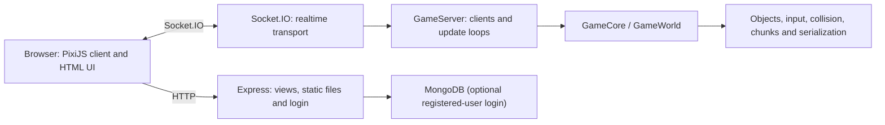
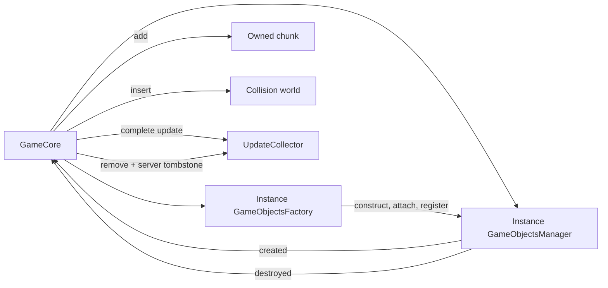
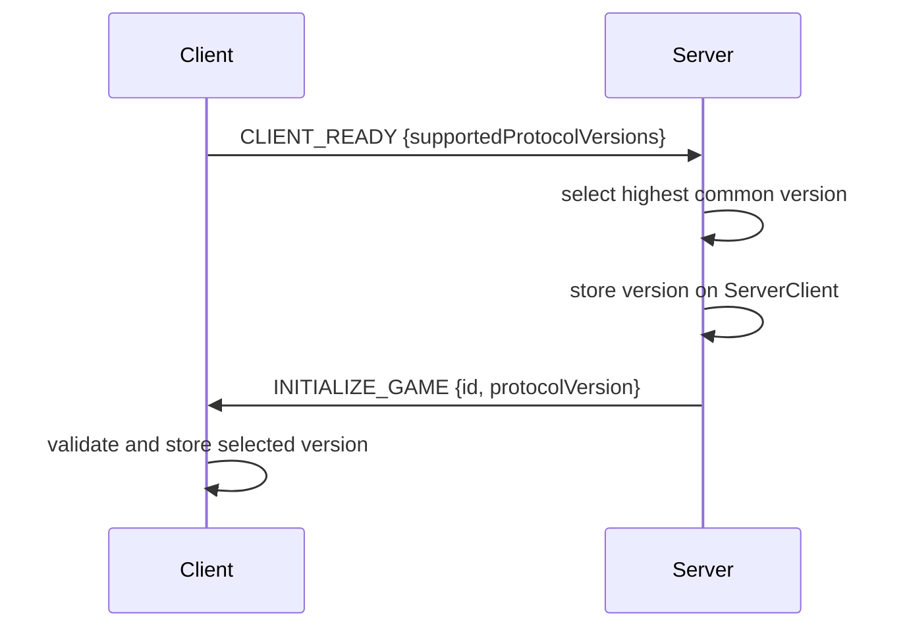

# Architecture

This document describes the code that exists today and the boundaries planned for the refactor. It is not a claim that the current implementation is production-ready.

## Runtime overview

The server is authoritative: it owns the world, advances simulation ticks and sends state updates. The browser captures input, renders the world and contains reconciliation code. Code under `shared/` is compiled for both environments.

## Current source boundaries

- `app.ts` configures Express, sessions, login and Socket.IO, then starts the game server.
- `server/` owns connected-client state, input consumption, game loops and optional MongoDB access.
- `client/` owns rendering, browser input, chat, heartbeat and reconciliation. Vite bundles its `Launcher.ts` entry to `dist/public/game.js`.
- `shared/` owns entities, physics, chunking, serialization and simulation utilities used on both sides.
- `public/` contains source-controlled CSS, images, maps and animation sheets. PixiJS 8.19.0 is an npm dependency bundled with the client; Express serves the generated client separately from `dist/public/` at `/build/`.

The browser entry in `views/game.ejs` points only at `/build/game.js`. This makes a clean `npm run build` the source of the executable client and avoids a second global renderer script whose version could drift from the TypeScript imports.

## World ownership and object lifecycle

`GameCore` is the runtime composition root for world state. Every core constructs and owns one `GameObjectsManager`, one `GameObjectsFactory`, its chunks, update collector and collision world. There is no longer a static object map, static runtime ID counter or process-wide create/destroy callback array. Two cores may both contain an object named `C0` without sharing the object, chunk membership or lifecycle notifications.

Creation is transactional at the registry boundary. The factory rejects unknown prefabs, invalid or mismatched IDs, non-finite positions and duplicate IDs before an existing entry can be replaced. If a create subscriber fails, registration destroys the partial object, removes it from owned systems and reports the collected errors. Lifecycle delivery is paired: a subscriber receives `destroyed` only for objects whose creation was delivered to that subscription. Destruction removes the registry entry before notifying subscribers; listener failures are aggregated after later listeners and cleanup have had a chance to run. `GameCore.dispose()` destroys all remaining objects, clears subscriptions and is idempotent.

Chunk deactivation serializes persistent objects and destroys the live instances. Reload deserializes through the same core's factory, preserving wire IDs and restoring registry, chunk and collision ownership. On the server, destroy tombstones are keyed by the object's recorded old chunk rather than a potentially changed transform. Re-creating the same ID during reload removes its pending tombstone, so an unload/reload cycle does not also announce that restored object as deleted.

Default prefab wire prefixes are explicit and stable:

| Prefix | Prefab |
| --- | --- |
| `A` | `DefaultPlayer` |
| `B` | `Michau` |
| `C` | `Wall` |
| `D` | `HpPotion` |
| `E` | `Doors` |
| `F` | `FireBall` |
| `G` | `Portal` |
| `H` | `PlatformTriggerTest` |

## Protocol negotiation

Protocol v1 freezes the application-level Socket.IO event names to their existing one-code-unit values:

| Code | Event | Code | Event |
| ---: | --- | ---: | --- |
| `0` | `CHAT_MESSAGE` | `6` | `FIRST_UPDATE_GAME` |
| `1` | `CLIENT_READY` | `7` | `UPDATE_GAME` |
| `2` | `HEARTBEAT` | `8` | `HEARTBEAT_RESPONSE` |
| `3` | `INPUT_SNAPSHOT` | `9` | `UPDATE_SNAPSHOT_DATA` |
| `4` | `START_GAME` | `10` | `CHUNK_CHANGED` |
| `5` | `INITIALIZE_GAME` | `11` | `ERROR` |

`SocketMsgs` is frozen so those values cannot be reassigned at runtime. Socket.IO's transport-level `connection` and `disconnect` names remain strings outside the numbered application table.

`Protocol.SUPPORTED`, `CURRENT` and `LEGACY` are all v1 today. A new client advertises `[1]`; the server rejects malformed or unsupported offers before creating a player. To permit a rolling deployment, a missing `CLIENT_READY` payload is treated as a legacy v1 offer, while a client receiving `INITIALIZE_GAME` without `protocolVersion` treats it as legacy v1. Thus either old side can interoperate with the new negotiation checkpoint while both still speak identical v1 frames.

The selected version is connection context, not a version prefix added to each binary message. Existing v1 object and update frames remain byte-compatible and do not carry an explicit total-frame length, record count or schema hash. Their legacy one-byte string length and JavaScript-code-unit encoding also remain unchanged. Those framing, bounds and UTF-8 changes require a separately negotiated v2 codec and a dual-version rollout.

## Remaining coupling

The runtime registry migration removes shared object state, but several process-wide and implicit contracts remain:

- `SharedConfig` detects one global client/server origin.
- the prefab catalog is global even though default IDs `A` through `H` are explicit; registering additional prefabs still changes shared process state.
- serialization metadata and the wire format depend on decorator declaration order.
- protocol negotiation is explicit, but v1 frames lack a total length, record count and schema hash.
- game loops own their timers, which makes the simulation difficult to run deterministically in tests.

These are constraints for incremental refactoring, not reasons for a rewrite.

## Target boundaries

The first large refactor should converge on four explicit modules:

1. `core`: a deterministic `World` with entities and systems; no DOM, Express, Socket.IO, MongoDB or PixiJS imports.
2. `protocol`: versioned messages, validation, codecs and compatibility rules.
3. `server`: transport, sessions, persistence, client lifecycle and scheduling.
4. `client`: rendering, UI, input, prediction and reconciliation.

The target `World` receives a clock, ID source and random source, owns its registry, and advances only through an explicit `tick(delta)` call. Networking should translate messages at the edge instead of being embedded in domain objects.

## Refactor constraints

- Keep the server authoritative.
- Preserve behavior with characterization tests before moving code.
- Do not combine the remaining PixiJS, collision-engine and wire-protocol migrations in one change.
- Keep Socket.IO during the protocol refactor; transport replacement is a separate decision.
- Do not introduce an ECS until profiling demonstrates a concrete need.
- Every protocol-breaking change requires an explicit protocol version and compatible deployment plan.

## First-stage roadmap

1. Establish reproducible CI, tests and a documented baseline.
2. Fix payload validation, connection lifecycle leaks and remotely triggerable failures.
3. Generate the browser client reproducibly while preserving PixiJS 4 behavior. **Complete.**
4. Move rendering to the npm PixiJS 8 API and remove the checked-in browser global. **Complete.**
5. Move global world state behind instance-owned interfaces. **Runtime object registry complete; `SharedConfig` and the prefab catalog remain.**
6. Introduce a versioned, bounded and UTF-8-safe protocol. **v1 negotiation complete; bounded UTF-8 v2 frames remain.**

The next client-quality stage is a deterministic browser fixture with pinned visual snapshots. Until then, renderer changes require the manual WebGL comparison in [Testing](testing.md).

The exit criteria for this stage are documented in [Testing](testing.md), with current blockers in [Known issues](known-issues.md).
