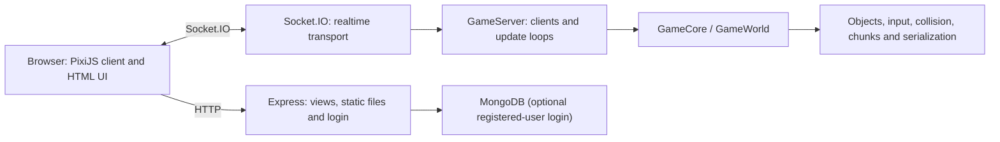

# Architecture

This document describes the code that exists today and the boundaries planned for the refactor. It is not a claim that the current implementation is production-ready.

## Runtime overview

The server is authoritative: it owns the world, advances simulation ticks and sends state updates. The browser captures input, renders the world and contains reconciliation code. Code under `shared/` is compiled for both environments.

## Current source boundaries

- `app.ts` configures Express, sessions, login and Socket.IO, then starts the game server.
- `server/` owns connected-client state, input consumption, game loops and optional MongoDB access.
- `client/` owns rendering, browser input, chat, heartbeat and reconciliation.
- `shared/` owns entities, physics, chunking, serialization and simulation utilities used on both sides.
- `public/` contains static assets plus a checked-in legacy browser bundle and PixiJS build.

## Important coupling

The current boundaries are only directory-level boundaries. Several global/static structures make instances share mutable state:

- `GameObjectsFactory` stores process-wide IDs and callback arrays.
- `GameObjectsManager` stores a process-wide object map.
- `SharedConfig` detects one global client/server origin.
- prefab registration is now explicitly bootstrapped at both entry points, but short wire IDs still depend on registration order.
- serialization metadata and the wire format depend on decorator declaration order.
- game loops own their timers, which makes the simulation difficult to run deterministically in tests.

These are constraints for incremental refactoring, not reasons for a rewrite.

## Target boundaries

The first large refactor should converge on four explicit modules:

1. `core`: a deterministic `World` with entities and systems; no DOM, Express, Socket.IO, MongoDB or PixiJS imports.
2. `protocol`: versioned messages, validation, codecs and compatibility rules.
3. `server`: transport, sessions, persistence, client lifecycle and scheduling.
4. `client`: rendering, UI, input, prediction and reconciliation.

The target `World` receives a clock, ID source and random source, owns its registry, and advances only through an explicit `tick(delta)` call. Networking should translate messages at the edge instead of being embedded in domain objects.

## Refactor constraints

- Keep the server authoritative.
- Preserve behavior with characterization tests before moving code.
- Do not change the client bundler, PixiJS, collision engine and wire protocol in one change.
- Keep Socket.IO during the protocol refactor; transport replacement is a separate decision.
- Do not introduce an ECS until profiling demonstrates a concrete need.
- Every protocol-breaking change requires an explicit protocol version and compatible deployment plan.

## First-stage roadmap

1. Establish reproducible CI, tests and a documented baseline.
2. Fix payload validation, connection lifecycle leaks and remotely triggerable failures.
3. Replace the checked-in client bundle with a reproducible build while preserving behavior.
4. Move global world state behind instance-owned interfaces.
5. Introduce a versioned, bounded and UTF-8-safe protocol.

The exit criteria for this stage are documented in [Testing](testing.md), with current blockers in [Known issues](known-issues.md).
