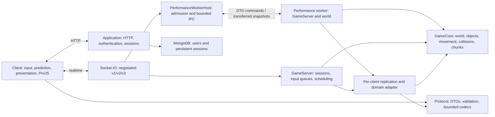
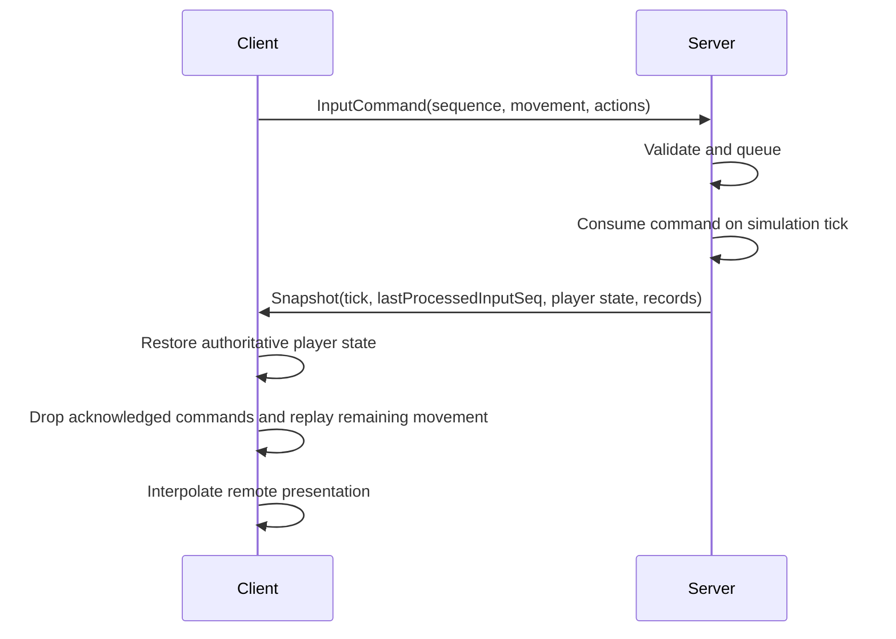

# Architecture

This describes the current refactor and its compatibility boundaries. It does not claim production capacity or pixel equivalence without the checks in [Testing](testing.md).

## Runtime and dependency boundaries



`shared/` means portable code used in both processes. Its internal boundaries matter more than the directory name:

| Area | Responsibility |
| --- | --- |
| `shared/core/`, objects, physics and chunks | Runtime context, game state, movement and simulation. |
| `shared/protocol/` | Validated transport DTOs, sequence arithmetic and v2/v3 encoding/decoding. No live-world mutation. |
| `shared/replication/` | Domain/state projection, snapshot application and each client's visibility baseline. |
| `shared/serialize/` | Legacy v1 compatibility metadata, codec, preflight and chunk snapshot bridge. |
| `server/` | Application composition, authenticated connections, scheduling and persistence. |
| `client/` | Browser input/UI, prediction, interpolation, renderers and resources. |

Separate TypeScript configurations and import-boundary checks prevent browser/server dependencies from leaking into portable modules. A single repository is sufficient; publishing packages, introducing an ECS and changing transport are not prerequisites for these boundaries.

The ordinary world stays on the main thread. The performance world runs in one dedicated `node:worker_threads` worker; its `GameCore`, input queues, physics, interest baselines and codecs have a single owner. HTTP, session validation, account lookup and Socket.IO remain on the main thread. `GameServer` depends on the small `GameTransport`/`GameConnection` interfaces, so both Socket.IO and an admitted worker connection use the same simulation and reconciliation logic. The worker receives a client ID, an authenticated user ID and a sanitized display name, never a socket, session object or database handle.

IPC carries bounded plain DTOs in input order. Delivery ACKs bound the bridge's memory and do not acknowledge simulated movement: `lastProcessedInputSeq` still advances only after authoritative processing. Outgoing snapshots transfer their owned `ArrayBuffer`s to the main thread. Bridge receipt means queued to transport, not delivered to the browser. Queue overflow disconnects the affected client instead of dropping an incremental snapshot or STOP command. Per-client and global byte/message bounds also cover slow admission and outbound transport. Worker startup, failure, shutdown and restart belong to application lifecycle; a crashed world closes its clients without restarting an empty world behind existing connections.

The worker caps queued and in-flight output at 32 MiB globally. The host separately caps the Engine.IO queued packet buffer at 32 MiB; a batch already handed to the network transport is outside that counter. These are queue limits, not a total process memory budget. Input backlog and diagnostic requests have their own bounds. A slow network transport can close its entire Engine.IO connection to release its buffers; a worker failure closes only the performance namespace, leaving a shared ordinary-world connection alive.

## World ownership and fixed simulation

Every `GameCore` owns a `WorldContext`, object manager, factory, prefab catalog, chunks, collision system and update collector. The context captures immutable configuration plus injected clock and random functions. Runtime role, chunk dimensions and timers follow the owning context rather than mutable process-wide client/server flags. The remaining `SharedConfig` API supplies legacy construction defaults; changing it after construction does not reconfigure a live world.

`ReplicatedState` defers allocating a fallback context until an unattached object first reads `Runtime`. Factories normally attach the owner's exact context first and propagate it to nested transforms, avoiding a temporary context for each newly constructed object and transform. Constructor-time change bookkeeping retains the default server semantics without requiring a context allocation. Standalone instances still receive independent fallback contexts, and a later owner attachment replaces an already requested fallback. The protected `runtime` getter/setter remains available to subclasses.

```ts
const core = new GameCore({
    role: Origin.SERVER,
    fixedDeltaMs: 1000 / 64,
    maxCatchUpSteps: 8,
    chunkSize: 1280,
    numOfChunksX: 5,
    numOfChunksY: 5,
    clock,
    random,
});

core.step();            // One simulation step with the configured duration.
core.advance(elapsed);  // Accumulate elapsed time into bounded fixed steps.
```

The default simulation frequency is 64 Hz. `advance()` limits catch-up to eight steps and records discarded backlog in `droppedTimeMs`. Chunk deactivation follows simulation `timeMs`, so explicit stepping produces the same world lifecycle regardless of wall-clock pace. Connection/session expiry still uses real time. Rendering and network snapshot scheduling are separate from simulation stepping. Tests can drive the same world without sleeping or starting application timers.

The dedicated performance worker uses the same default eight-step limit as the ordinary world; an explicitly configured limit still takes precedence. Catch-up executes actual fixed-duration simulation steps, including AI and collisions. Delay beyond the bounded backlog is still recorded as discarded time; loading and reconfiguration never reset that counter.

Performance population loading has both a maximum of 80 creations per tick and a default CPU-time target of 1 ms. Timing includes construction, registration and spatial insertion, measured by an injectable monotonic clock. The controller reduces the creation allowance when the previous non-creation part of a tick leaves less than 1 ms of safety margin. It checks the budget after each completed creation and always creates at least one pending enemy, so an individual creation or GC pause can exceed the target but loading cannot stall indefinitely. Existing objects still receive every simulation update. Position validation precedes replacement, and cancellation or disposal discards the old pending work.

At the beginning of a world update, the runtime captures a stable set of objects. Destroying an object cannot skip the following object; objects destroyed before their turn are ignored, and spawned objects begin their updates on the next tick. Collision batches also tolerate lifecycle mutation. Source/target registration is rechecked after callbacks, current contacts remain reachable by cleanup, and colliders sharing one parent are filtered out. Collider geometry follows position, rotation and scale changes.

Server timers follow monotonic deadlines. Callback duration is deducted from the next wait; expired scheduling deadlines are skipped rather than queued. `GameCore` still owns bounded fixed-step catch-up, while every scheduled callback yields through a timer so transport and other worlds can run.

Collision interest is directional. Stock actors can omit nonsolid contacts when their normal collision hooks only resolve solid geometry; triggers and custom hooks retain general processing. A conservative solid-candidate index also avoids querying the broadphase when no object can supply solid geometry. Doors, custom objects, subclasses and altered solidity getters keep the general path and its candidate order. Stock projectiles can reject stable owner/team contacts before narrowphase; unknown ownership and custom behavior use the full path. The other endpoint continues processing its own contacts, so pickups, portals and hostile projectiles retain their effects.

Current directional contacts have a reverse index, so deleting a collider visits only its actual incoming/outgoing contacts. Recursive callbacks can replace a source's published contact set; only the currently published set belongs in that reverse index. The standard player trigger can also omit broadphase when the conservative candidate index is empty: its only domain effect is toggling Doors, which remain candidates even while open. Altered trigger/collider hooks retain general processing and previous contacts still receive their normal exit handling.

The final geometry publication in a world tick or replayed movement step calls `updateGeometry()`: it updates the full BVH immediately and marks contact capabilities dirty. The next full `update()` refreshes capabilities as usual. A direct contact query against a dirty index also runs full `update()` before processing, preserving policy-then-BVH order even if a custom solidity getter changes geometry. This avoids an unused second policy scan without deferring collision geometry. Contact callbacks remain sequential in the world worker; the isolated SAT worker-pool experiment is available through the performance benchmark, not enabled in the game.

Object registration is transactional at the registry boundary. Factories reject unknown prefabs, invalid positions and conflicting IDs; failed creation subscribers trigger cleanup. Destruction removes registry entries before subscriber delivery and continues cleanup through listener errors. Subscriptions receive paired lifecycle notifications. Core disposal is idempotent and remains isolated from other worlds, including worlds using the same object ID.

The object manager also maintains lazy live type indexes. An index preserves registry insertion order, includes subclasses and follows creation, rollback, destruction and disposal. Enemy targeting reads the player index instead of scanning every world object for each enemy; equal-distance targets retain their original tie order.

Default prefab mappings stay explicit:

| Prefix | Prefab |
| --- | --- |
| `A` | `DefaultPlayer` |
| `B` | `Michau` |
| `C` | `Wall` |
| `D` | `HpPotion` |
| `E` | `Doors` |
| `F` | `FireBall` |
| `G` | `Portal` |
| `H` | `PlatformTriggerTest` |
| `I` | `ExpeditionMarker` (new expedition) |

## Protocol and serialization

Protocol negotiation is connection context. New clients advertise `[3, 2, 1]`; the server selects the highest common version and echoes it in initialization. Missing fields in either direction map to v1 for a rolling upgrade. Malformed and unsupported offers fail before creating a player. Application event codes remain frozen at `0` through `11`; Socket.IO's own connection/disconnect events remain transport names.

V2 uses plain DTOs and explicit schema definitions. Prefab, field and type IDs do not depend on decorator execution, import order or runtime property enumeration. Text uses bounded UTF-8. Frames carry a version, lengths, record count, server tick, snapshot identity, input acknowledgement and batch metadata. Records identify create/update/destroy semantics; a complete local-player state accompanies reconciliation.

V3 carries the same DTOs using a separate compact codec: a combined kind/prefab tag, canonical unsigned varints for entity sequences and integers, and a field mask whose bits refer to explicit schema IDs. Remote floating-point values use float32; the complete authoritative local player uses float64 so reconciliation retains simulation precision. At the schema's coordinate limit of ±1,000,000, float32 rounding is at most 1/32 pixel. V1 and V2 bytes stay unchanged. See the [wire format](../shared/protocol/README.md).

`encodeSnapshot()` splits a snapshot at record boundaries. Current limits are 64 KiB per frame, 256 records per frame, 256 batches and 8 MiB per complete snapshot. Field schemas impose tighter bounds where needed. Unknown fields/types, invalid numbers and IDs, malformed UTF-8, truncation, inconsistent batches and oversized input fail with controlled protocol errors.

`decodeSnapshot()` validates the complete batch before application. The domain adapter also preflights object existence and prefab compatibility before mutating the world. This prevents a malformed tail or missing batch from partially applying a snapshot. Arbitrary exceptions inside user gameplay/lifecycle callbacks are not a general-purpose rollback transaction and remain a separate operational failure boundary.

V1 remains available with its historical record bytes. Its one-byte/code-unit string encoding, implicit field ordering and mask representation cannot be changed in place. External compatibility metadata and the legacy bridge preserve those contracts while domain objects use `ReplicatedState` for change bookkeeping. The v2 schema is independent of this legacy machinery. V1 golden fixtures, inherited-field tests, mask boundaries and bounded frame splitting protect the fallback.

Chunk deactivation serializes persistent objects through the owning world's bridge and removes live instances; reload uses that world's factory and preserves wire IDs. Server tombstones follow the recorded old chunk and are cancelled when the same ID is restored. Legacy update collection preserves pending changes while every target frame is built, then commits once, so encoding failure remains retryable.

## Authoritative input, prediction and visibility



The server owns simulation duration; clients cannot submit their own delta or position as authoritative state. Received commands are acknowledged only after the tick that consumes them. Sequence comparison handles uint32 wrap. Server input queues and client prediction history are bounded at 256 commands. Discrete actions execute on the server once and are excluded from local movement replay.

Performance input processing reserves queued commands for the remaining scheduled catch-up steps. `PendingSimulationSteps` includes the current step when read by a before-step subscriber: three due steps and three commands consume one command per step; five commands consume three, then one, then one. Only surplus commands need movement replay before the ordinary world update, avoiding repeated global collision work for commands that later world steps can process normally. Every consumed command still spends the elapsed-time movement budget and advances its ACK only after processing. AI observes the player's intermediate positions on successive world ticks; action order, shot origins, STOP and movement-credit limits remain covered by regressions. A manual step or a single due step retains bounded backlog replay.

`ReplicationSession` owns a baseline per connection. The current chunk and its neighbors define the candidate set. V3 further filters it to a rectangle extending 768 pixels horizontally and 512 vertically around the player, including conservative object bounds. This covers the 1024×576 viewport, camera look-ahead and prefetch; already known objects receive an extra 96 pixels of exit hysteresis. V1/V2 retain their original interest. Entering objects receive complete create records, changed visible objects receive updates, and leaving/destroyed objects receive removal records. The next baseline commits after successful encoding; another client's interest transition does not consume that state. Immutable entity captures are shared only within one publication; baselines and transitions remain independent.

Local v2/v3 prediction restores authoritative state, retires acknowledged commands and replays pending movement through shared movement/collision code. Remote presentation uses `SnapshotInterpolator`: a 100 ms interpolation delay, at most 32 samples per entity, and a hold on the newest known position when data stops arriving. The renderer's smoothing depends on elapsed time and does not select presentation classes from network ID prefixes.

Legacy clients retain v1 input/reconciliation semantics, with regressions for STOP retries, idle acknowledgements, collision geometry and leaving/returning interest. V2 is the path for tick/sequence-based synchronization; it does not reinterpret legacy timestamps in place.

Socket.IO remains a reliable ordered transport. UDP packet-loss assumptions from Source networking do not directly describe its application channel. Historical hit rewind/lag compensation is a separate gameplay feature, not a prerequisite for local movement reconciliation.

## Application and client lifecycle

`createApplication()` composes Express, session middleware, Socket.IO, the user repository and `GameServer`. Construction/import does not listen or start simulation timers. Start and stop are idempotent; startup failure closes owned resources; restart creates a fresh runtime. SIGINT/SIGTERM use the same shutdown. `GameServer` owns timer handles and its connection subscription, removes client maps even through destroy errors, and disposes its core. Demo world seeding is a scenario option rather than an implicit effect of starting any server instance.

`GameClient.dispose()` cancels RAF/input/network timers, removes callbacks/listeners, closes the socket and releases the renderer/core. Async renderer initialization handles disposal before completion. Resource registration/loading is idempotent for the same resource definition, so recreating the renderer does not duplicate assets or animation frames.

The ordinary expedition composes two server-side controllers: `ExpeditionController` owns the village round and party, while `AdventureController` owns six non-overlapping waves, recovery stages, ephemeral loot, purchases and per-run progression. `VillageMapController` creates static cover from the same deterministic tile/prop layout used by the renderer and navigation. Both advance only through the owning fixed-step core. Gameplay choices identify the caller's ready player through its connection; clients cannot submit XP, levels, builds or another player's identity. Separate validated adventure DTOs drive the HUD without extending the binary entity schemas. Existing marker entities carry nonpersistent loot; rewards are deferred until after destruction transactions so chunk unloading cannot restore consumed loot. Stopping/resetting the adventure cleans up projectiles even after their wave enemy owner has died. The performance worker does not instantiate this controller or apply adventure builds.

Authentication uses injected `UserRepository` and session-store contracts. Mongo connections expose explicit connect/close. Login regenerates session identifiers; logout destroys the store record and disconnects that session's sockets. Registered credentials use salted scrypt with atomic legacy migration. See [Authentication and lifecycle](authentication.md).

## Deliberate limits

The collision library remains pinned to 2.7.0. Engine replacement, broad gameplay changes, lag compensation, horizontal sharding and an ECS require their own evidence and compatibility decisions. Production capacity, long-running stability and GPU pixel equivalence require the measurements described in [Testing](testing.md) and [Known issues](known-issues.md).
